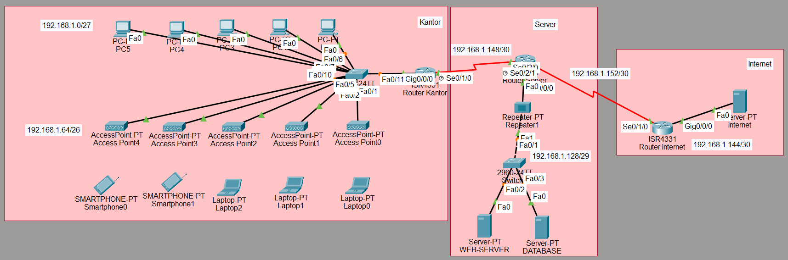

# Jaringan Kantor–Server–Internet: VLAN, DHCP, Wireless, dan OSPF (Cisco Packet Tracer)

Simulasi jaringan perusahaan yang terdiri dari tiga zona, yaitu **Kantor**, **Server**, dan **Internet**. Proyek ini mencakup pengalamatan IP dengan VLSM, VLAN dan *router-on-a-stick*, DHCP di router, jaringan nirkabel dengan 5 access point, dan routing dinamis **OSPF**.

> Proyek ini dikerjakan berdasarkan skenario praktik skema Junior Network Administrator. Teks soal asli tidak disertakan; kebutuhan ditulis ulang dengan kata-kata sendiri.



## Ringkasan

| Aspek | Isi |
|---|---|
| Simulator | Cisco Packet Tracer 9.0 |
| Perangkat | 3 router ISR4331, 2 switch 2960, 5 access point, 1 repeater, 3 server, 5 PC, 3 laptop, 2 smartphone |
| Addressing | `192.168.1.0/24` dipecah dengan VLSM (/27, /26, /29, /30) |
| Layer 2 | VLAN 10 (KABEL), VLAN 20 (NIRKABEL), trunk 802.1Q |
| Layer 3 | *Router-on-a-stick* dan DHCP server di R-Kantor |
| Routing | OSPF proses 1, area 0 |
| Layanan | Web `jayaabadi.com` dan database `db.jayaabadi.com` |

## Fitur utama

- **VLSM:** setiap segmen diberi blok sesuai kebutuhan host.
- **Inter-VLAN routing:** satu link trunk dari switch ke R-Kantor dengan subinterface `.10` dan `.20`.
- **DHCP:** pool `KABEL` dan `NIRKABEL` di R-Kantor, dengan DNS menuju WEB-SERVER.
- **Nirkabel:** 5 AP (SSID AP1–AP5), masing-masing melayani 10 perangkat.
- **OSPF area 0:** R-Kantor, R-Server, dan R-Internet saling bertukar rute secara otomatis.
- **Layanan:** website dan database dapat diakses lewat nama domain.

## Rancangan IP

| Segmen | Network | Prefix | Gateway |
|---|---|---|---|
| LAN Kabel (VLAN 10) | 192.168.1.0 | /27 | .1 |
| LAN Nirkabel (VLAN 20) | 192.168.1.64 | /26 | .65 |
| LAN Server | 192.168.1.128 | /29 | .129 |
| LAN Internet | 192.168.1.144 | /30 | .145 |
| Link Kantor–Server | 192.168.1.148 | /30 | — |
| Link Server–Internet | 192.168.1.152 | /30 | — |

Tabel lengkap ada di [docs/01-perancangan-ip.md](docs/01-perancangan-ip.md).

## Struktur repository

```
.
├── README.md
├── LICENSE
├── topology/
│   ├── jaringan-kantor.pkt      # buka dengan Packet Tracer 9.0+
│   └── topologi.png
├── configs/                     # running-config tiap perangkat
│   ├── R-Kantor.txt
│   ├── R-Server.txt
│   ├── R-Internet.txt
│   ├── SW-Kantor.txt
│   └── SW-Server.txt
├── docs/
│   ├── 01-perancangan-ip.md
│   ├── 02-switch-vlan-dhcp.md
│   ├── 03-jaringan-nirkabel.md
│   ├── 04-routing-ospf.md
│   └── 05-pengujian.md
└── screenshots/
```

Catatan: file `.pkt` juga memuat segmen Manajemen dengan eBGP yang berada di luar cakupan dokumentasi ini, sehingga konfigurasi router di `configs/` memuatnya juga.

## Cara menjalankan

1. Pasang Cisco Packet Tracer **9.0 atau lebih baru**.
2. Buka `topology/jaringan-kantor.pkt` dan tunggu OSPF konvergen.
3. Coba dari PC: `ping 192.168.1.130`, `tracert 192.168.1.146`, atau buka `http://jayaabadi.com` dari laptop.

## Hasil pengujian

| Pengujian | Bukti |
|---|---|
| VLAN dan port switch | [screenshot](screenshots/06-vlan-port-switch.png) |
| Routing antar-VLAN | [ping](screenshots/07-ping-antar-vlan.png) |
| Nirkabel ke server dan internet | [ping laptop](screenshots/09-ping-laptop-wireless.png) |
| Tabel OSPF | [R-Kantor](screenshots/10-ip-route-r-kantor.png), [R-Server](screenshots/11-ip-route-r-server.png), [R-Internet](screenshots/12-ip-route-r-internet.png) |
| Jalur ke server dan internet | [tracert](screenshots/13-tracert-pc0.png) |
| Website dan database | [jayaabadi.com](screenshots/14-web-jayaabadi.png), [db.jayaabadi.com](screenshots/15-web-db-jayaabadi.png) |

## Ide pengembangan

Enable secret dan SSH, OSPF authentication, NAT/PAT ke segmen Internet, port security dan DHCP snooping di switch.

## Penulis

**Ferry Achmad Akbar** — [GitHub](https://github.com/FerryAchmadAkbar) 

