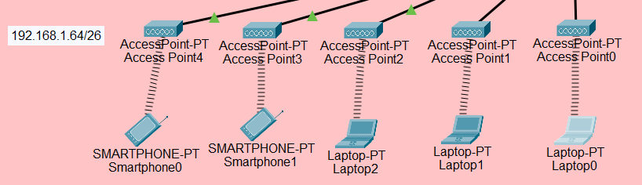
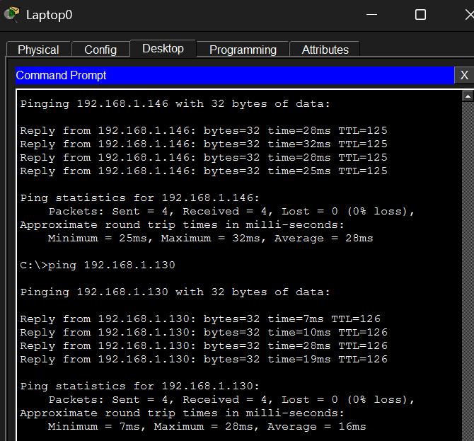

# 03 — Jaringan Nirkabel

| Parameter | Nilai |
|---|---|
| Perangkat nirkabel maksimal | 50 |
| Kapasitas per AP | 10 perangkat |
| Jumlah AP | 5 |
| Bandwidth per perangkat | 10 Mbps |
| Akses | Internet |

| AP | Port switch | SSID |
|---|---|---|
| Access Point0 | Fa0/1 | AP1 (WPA-PSK, AES) |
| Access Point1 | Fa0/2 | AP2 |
| Access Point2 | Fa0/3 | AP3 |
| Access Point3 | Fa0/4 | AP4 |
| Access Point4 | Fa0/5 | AP5 |

Semua AP terhubung ke port access VLAN 20, sehingga klien nirkabel berada di `192.168.1.64/26` dan mendapat IP dari DHCP.

## Pengujian

Laptop yang terhubung ke AP mendapat IP dari DHCP, lalu berhasil mengakses server internet (`192.168.1.146`) dan WEB-SERVER (`192.168.1.130`) tanpa packet loss.

